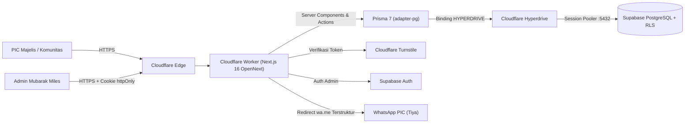
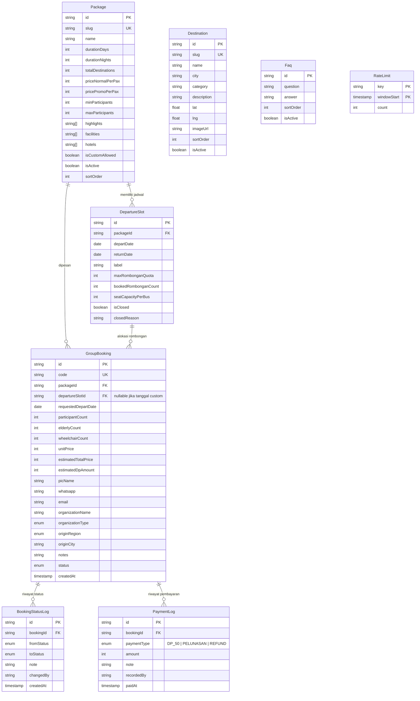
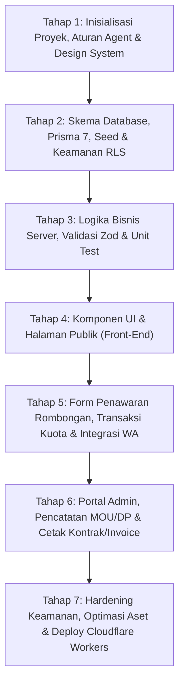

# Implementation Plan — Website Mubarak Miles Tour (Wisata Religi Ziarah Wali Songo B2B)

> **Status:** Rencana Implementasi (Belum membuat kode website). Diperbarui: 20 Oktober 2026.
> **Identitas Brand Resmi:** **Mubarak Miles Tour**
> **Model Bisnis Terkonfirmasi:** **B2B Rombongan / Komunitas** (Majelis Taklim, Muslimat/Fatayat NU, Komunitas, Pondok Pesantren, Yayasan, Sekolah/Madrasah). Harga per jamaah (Rp1.399.000/kepala) adalah patokan harga per orang dalam kontrak satu rombongan bus (±40 jamaah).
> **Sumber Referensi:**
> - [`brave-franklin/website.md`](file:///c:/Users/ThinkPad/Documents/antigravity/brave-franklin/website.md) & [`CLAUDE.md`](file:///c:/Users/ThinkPad/Documents/antigravity/brave-franklin/CLAUDE.md): Arsitektur teknis, standar keamanan Zero-Trust, kunci kuota transaksional (`SELECT ... FOR UPDATE`), konfirmasi WhatsApp, dan panel admin.
> - [dreamtour.co](https://www.dreamtour.co/): Navbar pill + dropdown, hero slider, kartu paket lengkap (durasi, hotel, harga), counter statistik, testimoni, kartu konsultasi mengambang di atas footer.
> - [royalholidayid.netlify.app](https://royalholidayid.netlify.app/): Hero dengan statistik, kartu "Kenapa Kami", kartu destinasi, galeri bento, FAQ accordion, CTA akhir, tombol WA mengambang.
> - `Referensi/BROSUR MUBARAK MILES TOUR.zip`: Identitas visual (hijau emerald + emas krem), 6 fasilitas utama, paket 3H2M 12 destinasi, harga promo Rp1.399.000/pax, jadwal 1–3 Februari 2027, kontak PIC.
> - `Referensi/PPBI Kel 26 Tjuan_TM 8.pdf`: Filosofi B2B, 5 pilar keunggulan, akad syariah (*Ijarah Maushufah fi adz-Dzimmah*, *Wakalah bil Ujrah*, *Tabarru'*), alur MOU → DP 50% (H-30) → Pelunasan (H-14) → Grup WA → Persiapan (H-7) → Keberangkatan.

---

## 1. Ringkasan Proyek & Alur Bisnis B2B

**Mubarak Miles Tour** melayani perjalanan ziarah Wali Songo + wisata religi khusus **rombongan terstruktur (B2B)** dari Surabaya dan Jawa Timur.

### 1.1 Karakteristik Model Pemesanan (B2B Rombongan)
1. **Harga Per Kepala untuk Kontrak Rombongan:**
   - Harga yang ditampilkan di website (~~Rp1.499.000~~ **Rp1.399.000 / jamaah**) adalah harga *All-In Zero-Cash Hassle* per kepala untuk keberangkatan satu rombongan (kapasitas ideal **40 jamaah / 1 bus**).
2. **Satu Jalur Konversi Utama — Permintaan Penawaran & Booking Rombongan:**
   - Calon klien adalah **pengurus/ketua/PIC rombongan** (Majelis Taklim, Komunitas, Pesantren, Yayasan, Sekolah).
   - PIC memilih **Paket Rombongan** (mis. *Paket 3H2M 12 Destinasi* atau *Paket Custom Rombongan*) dan memilih **Slot Jadwal Keberangkatan** yang tersedia (mis. *1–3 Februari 2027* atau mengajukan tanggal pilihan komunitas).
   - PIC mengisi data komunitas/instansi, estimasi jumlah jamaah (mis. 35–45 orang), jumlah jamaah lansia, kebutuhan kursi roda lipat, serta titik jemput.
   - Server mengunci slot keberangkatan secara transaksional (`SELECT ... FOR UPDATE`), menghitung estimasi total kontrak & nilai DP 50% (`unitPrice × participantCount`), menyimpan data ke database, membuat kode unik (8 karakter CSPRNG, mis. `MMT-8K2P9X1A`), lalu mengarahkan PIC ke **WhatsApp resmi (Tiya)** dengan format pesan penawaran terstruktur.
3. **Alur Lanjutan Pasca-Form (Sesuai Dokumen PPBI 6.2):**
   - `MENUNGGU_PENAWARAN` (form masuk & WA terkirim) → `MOU_DITANDATANGANI` (kesepakatan & materai) → `DP_DITERIMA` (DP ≥ 50% maks. H-30) → `LUNAS` (pelunasan maks. H-14 + pembuatan Grup WA koordinasi + kesiapan H-7) → `SELESAI` (trip terlaksana & LPJ/dokumentasi diserahkan), atau `BATAL`.

### 1.2 Data Bisnis Referensi Awal (Disimpan di Database / Env)
| Item | Nilai Awal | Sumber |
|---|---|---|
| Nama Brand | **Mubarak Miles Tour** | Konfirmasi Klien & Brosur |
| Paket Utama | Ziarah Wali Songo + Tour Wisata (**3 Hari 2 Malam**, **12 Destinasi**) | Brosur |
| Highlight Destinasi | Makam Walisongo, Masjid Agung Jateng, Kota Lama Semarang, Masjid Demak | Brosur |
| Harga Paket All-In | ~~Rp1.499.000~~ **Rp1.399.000 / jamaah** (skema rombongan ±40 pax) | Brosur & PPBI 6.5 |
| Slot Jadwal Perdana | **1–3 Februari 2027** (Keberangkatan Surabaya, Jawa Timur) | Brosur |
| Fasilitas All-In | Hotel Bintang 3 (Lasnur Pallace Tegal, De La Charis Tuban), Konsumsi 3x Sehari, Transportasi Bus AC Berizin SPIONAM/BLUE, Muthawwif Profesional, Dokumentasi, Handbook Ziarah, Asuransi Perjalanan Syariah | Brosur & PPBI 1.1 |
| Fasilitas Lansia | Kursi roda lipat (sesuai permintaan), 2 tabung oksigen portabel (*Oxycan*), titik transit higienis | PPBI 1.1 |
| Skema Pembayaran | MOU di atas materai → DP ≥ 50% (maks. H-30) → Pelunasan 50% (maks. H-14) | PPBI 6.2 |
| Kontak Resmi | WA: `0858-4787-9784` (Tiya), IG: `@mubarakmiles_tour`, Email: `mubarakmilestour@gmail.com` | Brosur |

---

## 2. Arsitektur Teknis (Mengikuti `brave-franklin`)

### 2.1 Tech Stack
- **Framework**: Next.js 16 (App Router, React Server Components, Server Actions, TypeScript `strict: true`).
- **Styling**: Tailwind CSS v4 (design tokens di `src/app/globals.css`, WCAG AA contrast, dukungan `prefers-reduced-motion`).
- **Edge Deployment**: Cloudflare Workers via `@opennextjs/cloudflare` (target ukuran bundle Worker < 3 MiB gzip).
- **Database & Connection Pooling**: PostgreSQL di Supabase (`ap-southeast-1`) dihubungkan via **Cloudflare Hyperdrive** ke Supabase Session Pooler (port `5432`).
- **ORM**: Prisma 7 dengan `@prisma/adapter-pg` dan query compiler `small`.
- **Autentikasi Admin**: Supabase Auth (`@supabase/ssr` dengan cookie `httpOnly`) + allowlist email di `ADMIN_EMAILS`. Proteksi dua lapis di Layout Server dan di setiap Server Action (tanpa `middleware.ts` untuk menghemat ±1,3 MiB bundle Worker).
- **Keamanan & Validasi**: Cloudflare Turnstile (anti-bot), Zod 4 (`.strict()`), Honeypot input tersembunyi, Rate Limiting berbasis tabel Postgres (`RateLimit`), dan RLS Zero-Trust (`REVOKE ALL` untuk `anon` & `authenticated`).
- **Peta Interaktif**: Leaflet + OpenStreetMap (di-*lazy load* via `next/dynamic` dengan `ssr: false`).

### 2.2 Diagram Arsitektur

---

## 3. Arsitektur Database & Skema Prisma

Dibandingkan `brave-franklin` yang menggunakan sesi jam harian (`Session` + `SessionSlot`), **Mubarak Miles Tour** menggunakan jadwal keberangkatan multi-hari (`DepartureSlot`) dengan kapasitas kuota rombongan bus per keberangkatan, serta mendukung pengajuan tanggal custom oleh komunitas.

### 3.1 Entity-Relationship Diagram (ERD)

### 3.2 Enum & Aturan Integritas Database (CHECK Constraints)
- **`OrganizationType`**: `MAJELIS_TAKLIM`, `KOMUNITAS`, `PESANTREN`, `YAYASAN`, `SEKOLAH`, `LAINNYA`.
- **`OriginRegion`**: `SURABAYA_RAYA` (Surabaya, Sidoarjo, Gresik, Bangkalan), `JAWA_TIMUR_LAINNYA`, `LUAR_JAWA_TIMUR`.
- **`BookingStatus`**: `MENUNGGU_PENAWARAN` → `MOU_DITANDATANGANI` → `DP_DITERIMA` → `LUNAS` → `SELESAI`, atau `BATAL`.
- **CHECK Constraints SQL**:
  - `Package.priceNormalPerPax >= 0 AND Package.pricePromoPerPax >= 0`
  - `Package.minParticipants >= 1 AND Package.maxParticipants >= Package.minParticipants`
  - `GroupBooking.participantCount >= 1`
  - `GroupBooking.elderlyCount >= 0 AND GroupBooking.elderlyCount <= GroupBooking.participantCount`
  - `GroupBooking.wheelchairCount >= 0 AND GroupBooking.wheelchairCount <= GroupBooking.participantCount`
  - `GroupBooking.estimatedTotalPrice = GroupBooking.unitPrice * GroupBooking.participantCount`
  - `DepartureSlot.bookedRombonganCount >= 0 AND DepartureSlot.bookedRombonganCount <= DepartureSlot.maxRombonganQuota`

---

## 4. Desain Front-End & Susunan Section (One-Page Landing)

### 4.1 Design Tokens (Dari Brosur Mubarak Miles Tour)
| Token | Hex | Penggunaan |
|---|---|---|
| `emerald-deep` | `#0B3528` | Background gelap utama, hero overlay, footer |
| `emerald-mid` | `#124E3B` | Background section hijau selang-seling, navbar scrolled |
| `sage-card` | `#637D5C` | Kartu fitur di atas background gelap (sesuai kartu "Kenapa harus Kami?" di brosur) |
| `cream` | `#F6EFE2` | Background section terang, teks utama di atas background gelap |
| `sand` | `#EAE0CE` | Background kartu/form pada section terang |
| `gold` | `#E8D29B` | Badge harga, aksen judul, garis pembatas, tombol utama di atas gelap |
| `gold-dark` | `#9A7422` | Eyebrow & aksen pada background terang (memenuhi kontras WCAG AA) |
| `ink` | `#102820` | Teks utama di atas background terang |
| `promo-red` | `#C92A2A` | Harga coret (`Rp1.499.000`) |

- **Tipografi** (`next/font/google`):
  - Heading: **Plus Jakarta Sans** (700, 800) — tegas, bersih, dan mudah dibaca oleh pengurus majelis taklim segala usia.
  - Sub-heading / Aksen Religi: **Cormorant Garamond** atau **Playfair Display** (600, italic).
  - Body: **Plus Jakarta Sans** (400, 500, 600).

### 4.2 Urutan Section Halaman Publik (`src/app/(public)/page.tsx`)
1. **Navbar (`Navbar.tsx`)**:
   - Gaya *pill floating* (adaptasi Dreamtour) dengan logo kompas-sabit Mubarak Miles Tour.
   - Menu: *Beranda, Tentang, Keunggulan, Paket & Jadwal, Rute & Hotel, Alur Pemesanan, FAQ*.
   - Tombol CTA kanan: *"Ajukan Penawaran Rombongan"* (scroll ke form pemesanan).
2. **Hero Cross-Fade Carousel (`Hero.tsx`)**:
   - Slider *cross-dissolve* (adaptasi `brave-franklin`) menampilkan foto Masjid Demak, Menara Kudus, Masjid Agung Jateng, dan Kota Lama Semarang.
   - Badge atas: `✦ Ziarah Wali Songo + Tour Wisata · Khusus Rombongan & Majelis Taklim`.
   - Headline: *"Perjalanan Ziarah Wali Songo yang Aman, Nyaman, & Ramah Lansia"*.
   - Strip Fakta (adaptasi Royal Holiday): **3 Hari 2 Malam** · **12 Destinasi** · **40 Kursi/Bus** · **All-In Tanpa Pungutan Liar**.
3. **Tentang Kami & Segmen Komunitas (`About.tsx`)**:
   - Penjelasan fokus B2B Mubarak Miles Tour beserta kartu segmen: *Majelis Taklim (Muslimat/Fatayat NU), Komunitas Pengajian, Pondok Pesantren, Yayasan & Lembaga Pendidikan*.
4. **Kenapa Harus Kami & 5 Pilar Amanah (`WhyUs.tsx`)**:
   - 6 Kartu fasilitas utama dari brosur (*Professional Muthawwif, Travel Insurance Syariah, Akomodasi & Transport Resmi SPIONAM/BLUE, Travel Documentation, Ziarah Handbook, Konsumsi 3x Sehari*) + highlight **Fasilitas Ramah Lansia (Kursi Roda Lipat & Tabung Oksigen Oxycan)** serta **Prinsip Syariah Zero-Cash Hassle**.
5. **Paket Perjalanan & Jadwal Keberangkatan (`Packages.tsx`)**:
   - Kartu Paket Utama (adaptasi kartu paket Dreamtour + brosur):
     - Durasi **3 Hari 2 Malam · Total 12 Destinasi**.
     - Harga All-In: ~~Rp1.499.000~~ **Rp1.399.000 / jamaah** (kontrak rombongan ±40 jamaah).
     - Jadwal terdekat: **1–3 Februari 2027** (status ketersediaan kuota real-time dari database).
     - Kartu pendamping: **Paket Custom Rombongan** (bebas pilih tanggal keberangkatan & titik jemput untuk komunitas Anda).
6. **Peta Rute 12 Destinasi & Hotel (`MapAndHotels.tsx`)**:
   - Peta interaktif Leaflet yang menampilkan titik-titik makam Wali Songo & destinasi wisata (Surabaya → Tuban → Kudus → Demak → Semarang → Tegal), dipadukan dengan kartu foto hotel bintang 3 (*Lasnur Pallace Tegal* & *De La Charis Tuban*).
7. **Alur Pelayanan Rombongan Deal s.d. Berangkat (`ProcessFlow.tsx`)**:
   - Visualisasi 7 langkah resmi dari laporan PPBI: *1. Pilih Paket/Custom → 2. Tanda Tangan MOU Bermaterai → 3. DP 50% (Maks. H-30) → 4. Pelunasan 50% (Maks. H-14) → 5. Grup WA Koordinasi Panitia → 6. Persiapan Final & Ramp Check Bus (H-7 s.d. H-1) → 7. Keberangkatan*.
8. **Form Permintaan Penawaran & Booking Rombongan (`BookingSection.tsx` & `BookingForm.tsx`)**:
   - Form interaktif satu pintu untuk PIC komunitas:
     - Pilihan Paket & Pilihan Jadwal (Slot tersedia atau *Tanggal Custom Komunitas*).
     - Nama Majelis Taklim / Komunitas / Instansi & Jenis Lembaga.
     - Nama PIC, Nomor WhatsApp PIC, Email (opsional), Asal Kota/Kabupaten.
     - Estimasi Jumlah Jamaah, Estimasi Jamaah Lansia (>60 thn), Kebutuhan Kursi Roda Lipat.
     - Kalkulator estimasi otomatis di layar: menampilkan **Estimasi Total Kontrak** dan **Estimasi DP 50%** (tetap dihitung ulang di server).
     - Proteksi Cloudflare Turnstile + Honeypot.
9. **FAQ & Konsultasi Floating Card (`Faq.tsx`)**:
   - Pertanyaan seputar sistem All-In, fasilitas lansia, mekanisme MOU & DP 50%, titik jemput rombongan, dan keamanan armada bus.
   - Kartu konsultasi mengambang di atas footer (adaptasi Dreamtour) + tombol WhatsApp mengambang di kanan bawah (adaptasi Royal Holiday).
10. **Footer (`Footer.tsx`)**:
    - Identitas Mubarak Miles Tour, kontak WA `0858-4787-9784 (Tiya)`, Instagram `@mubarakmiles_tour`, email `mubarakmilestour@gmail.com`, alamat Surabaya, Jawa Timur.

---

## 5. Tahap-Tahap & Langkah-Langkah Pembuatan Website (Step-by-Step)

Bagian ini adalah panduan eksekusi bertahap. Setiap tahap memiliki langkah-langkah berurutan, file yang dibuat, serta perintah verifikasi agar website dapat dibangun secara sistematis dan aman seperti pada proyek `brave-franklin`.

---

### Tahap 1 — Inisialisasi Proyek, Aturan Agent, & Design System
**Tujuan:** Menyiapkan fondasi proyek Next.js 16 + TypeScript strict + Tailwind CSS v4 + konfigurasi OpenNext Cloudflare, serta mendokumentasikan aturan kerja di `AGENTS.md`, `README.md`, dan `progres.md`.

- **Langkah 1.1 — Buat proyek Next.js & pasang dependensi inti:**
  1. Inisialisasi proyek Next.js (App Router, TypeScript, Tailwind CSS, `src/` directory).
  2. Pasang dependensi produksi: `@prisma/client`, `@prisma/adapter-pg`, `pg`, `@supabase/ssr`, `@supabase/supabase-js`, `zod`, `lucide-react`.
  3. Pasang dependensi dev: `prisma`, `@opennextjs/cloudflare`, `wrangler`, `vitest`, `@types/pg`.
- **Langkah 1.2 — Buat dokumen ingatan proyek (`AGENTS.md`, `README.md`, `progres.md`):**
  1. Buat `AGENTS.md` (adaptasi dari `brave-franklin/CLAUDE.md`) yang memuat urutan prioritas (Keamanan → Kebenaran Data → Kesesuaian Desain → Kecepatan) dan konteks bisnis B2B Mubarak Miles Tour.
  2. Buat `progres.md` dan `README.md` awal.
- **Langkah 1.3 — Konfigurasi Design Tokens & Tipografi:**
  1. Konfigurasi font `Plus Jakarta Sans` dan `Cormorant Garamond` di `src/app/layout.tsx` menggunakan `next/font/google`.
  2. Definisikan variabel warna (`emerald-deep`, `emerald-mid`, `sage-card`, `cream`, `sand`, `gold`, `gold-dark`, `ink`) di `src/app/globals.css`.
  3. Buat komponen UI dasar di `src/components/ui/`: `Container.tsx`, `Eyebrow.tsx`, `SectionHeading.tsx`, `Button.tsx`, dan `AnimateIn.tsx`.
- **Langkah 1.4 — Siapkan validasi Environment Variables (`src/lib/env.ts`):**
  1. Buat skema Zod di `src/lib/env.ts` (diawali `import "server-only"`).
  2. Buat `.env.example` dan `.dev.vars.example` (hanya nama variabel tanpa kredensial asli).
- **Verifikasi Tahap 1:** Jalankan `npm run typecheck` dan `npm run dev` untuk memastikan halaman kosong dengan design token tampil tanpa error.

---

### Tahap 2 — Skema Database, Prisma 7, Seed Data, & Keamanan RLS
**Tujuan:** Membangun skema database PostgreSQL di Supabase, menerapkan aturan integritas (`CHECK`), mengaktifkan Zero-Trust RLS, dan mengisi data awal sesuai brosur & laporan PPBI.

- **Langkah 2.1 — Susun `prisma/schema.prisma`:**
  1. Konfigurasi generator Prisma 7 (`provider = "prisma-client"`, `queryCompiler = "small"`, output ke `src/generated/prisma`).
  2. Definisikan model `Package`, `DepartureSlot`, `GroupBooking`, `BookingStatusLog`, `PaymentLog`, `Destination`, `Faq`, dan `RateLimit`.
- **Langkah 2.2 — Buat Script SQL Setup & Hardening (`prisma/manual/00-setup-database-baru.sql`):**
  1. Tambahkan `CHECK` constraints untuk harga, jumlah peserta, lansia, kursi roda, perhitungan total kontrak (`unitPrice * participantCount`), dan batas kuota rombongan.
  2. Aktifkan Row Level Security (`ALTER TABLE ... ENABLE ROW LEVEL SECURITY`) pada semua tabel tanpa policy publik.
  3. Tambahkan perintah `REVOKE ALL ON ALL TABLES/SEQUENCES/FUNCTIONS IN SCHEMA public FROM anon, authenticated;`.
- **Langkah 2.3 — Buat Script Seed (`prisma/seed.ts`) & Fallback Fixtures (`src/server/db/fixtures.ts`):**
  1. Isi paket utama: *Ziarah Wali Songo + Tour Wisata (3 Hari 2 Malam, 12 Destinasi)* dengan `priceNormalPerPax: 1499000`, `pricePromoPerPax: 1399000`, `minParticipants: 20`, `maxParticipants: 45`.
  2. Isi paket kedua: *Paket Custom Rombongan Majelis / Instansi*.
  3. Isi jadwal keberangkatan perdana: *1–3 Februari 2027* (`seatCapacityPerBus: 40`, `maxRombonganQuota: 2`).
  4. Isi data 12 destinasi rute ziarah (koordinat peta, kategori, kota) dan 2 hotel bintang 3 (*Lasnur Pallace Tegal*, *De La Charis Tuban*).
  5. Isi daftar FAQ resmi (sistem All-In, fasilitas lansia, MOU & DP 50% H-30, pelunasan H-14).
- **Langkah 2.4 — Buat Koneksi Database Server (`src/server/db/client.ts`):**
  1. Gunakan `@prisma/adapter-pg` yang membaca connection string dari binding Cloudflare `HYPERDRIVE` saat di Worker, atau `DIRECT_URL` saat lokal.
- **Verifikasi Tahap 2:** Jalankan `npx prisma generate`, eksekusi migrasi/seed ke database, dan pastikan query baca publik di `src/server/db/public.ts` berhasil mengembalikan data paket dan jadwal.

---

### Tahap 3 — Logika Bisnis Server, Validasi Input Zod, & Unit Test
**Tujuan:** Memisahkan seluruh perhitungan harga, DP 50%, aturan tanggal (WIB), pembuatan kode booking, dan format pesan WhatsApp ke modul murni di `src/server/booking/` yang diuji dengan Vitest.

- **Langkah 3.1 — Aturan Tanggal & Tenggat Waktu (`src/server/booking/dates.ts`):**
  1. Fungsi konversi tanggal ke zona waktu `Asia/Jakarta` (WIB).
  2. Fungsi perhitungan tenggat DP (H-30 sebelum keberangkatan, atau +2 hari jika pemesanan masuk kurang dari H-30 namun masih di atas H-14) dan tenggat pelunasan (H-14).
- **Langkah 3.2 — Perhitungan Harga & DP Rombongan (`src/server/booking/rules.ts`):**
  1. Fungsi penentu harga satuan (`pricePromoPerPax ?? priceNormalPerPax`) dari database.
  2. Fungsi hitung `estimatedTotalPrice = unitPrice * participantCount` dan `estimatedDpAmount = Math.ceil((estimatedTotalPrice * 0.5) / 1000) * 1000`.
  3. Validasi batas peserta (`minParticipants` s.d. `maxParticipants` untuk jadwal reguler, atau fleksibel untuk paket custom) serta validasi `elderlyCount` dan `wheelchairCount`.
- **Langkah 3.3 — Validasi Input & Normalisasi WhatsApp (`src/server/booking/input.ts`):**
  1. Skema Zod `.strict()` untuk form penawaran rombongan (batas karakter nama, nama majelis/instansi, kota asal, catatan).
  2. Normalisasi nomor WA Indonesia (`08...` / `+628...` → `628...`) dan validasi panjang digit.
- **Langkah 3.4 — Generator Kode & Builder Pesan WhatsApp (`code.ts` & `whatsapp.ts`):**
  1. Generator kode 8 karakter acak menggunakan `crypto.getRandomValues` (mis. `MMT-7K4P9X2A`).
  2. Builder URL `https://wa.me/<NOMOR_PIC>?text=...` dengan `encodeURIComponent` berisi: Kode Penawaran, Nama Majelis/Instansi, Nama PIC, Paket, Jadwal, Jumlah Jamaah (termasuk jumlah lansia & kursi roda), Estimasi Total All-In, Estimasi DP 50%, dan permohonan jadwal tanda tangan MOU.
- **Langkah 3.5 — Tulis Unit Test (`*.test.ts`):**
  1. Uji seluruh skenario di `rules.test.ts` dan `input.test.ts` (input valid, input manipulatif, jumlah lansia melebihi peserta, nomor WA tidak valid, perhitungan DP 50%).
- **Verifikasi Tahap 3:** Jalankan `npm test` (Vitest) dan pastikan 100% unit test hijau.

---

### Tahap 4 — Pembuatan Komponen UI & Halaman Publik (Front-End)
**Tujuan:** Membangun tampilan website satu halaman (*one-page landing*) yang memadukan estetika brosur Mubarak Miles Tour, Dreamtour, dan Royal Holiday.

- **Langkah 4.1 — Optimasi Aset Visual (`public/images/`):**
  1. Ekstrak dan konversi foto-foto destinasi dari materi referensi/brosur ke format `.webp` terkompresi di `public/images/`.
- **Langkah 4.2 — Bangun Section Navigasi, Hero, & Storytelling:**
  1. `Navbar.tsx`: Navigasi desktop pill + menu mobile drawer yang aksesibel dengan keyboard.
  2. `Hero.tsx`: Cross-fade image carousel + badge + CTA + strip statistik utama.
  3. `About.tsx`: Penjelasan profil Mubarak Miles Tour & 4 target komunitas utama (Majelis Taklim, Komunitas, Pesantren, Yayasan/Sekolah).
  4. `WhyUs.tsx`: 6 Kartu keunggulan brosur (warna `sage-card` di atas `emerald-deep`) + highlight 5 Pilar Amanah (Armada SPIONAM/BLUE, Ramah Lansia, All-In Zero-Cash Hassle).
- **Langkah 4.3 — Bangun Section Paket, Peta Rute, Hotel, & Alur MOU:**
  1. `Packages.tsx`: Kartu Paket 3H2M 12 Destinasi (harga coret Rp1.499.000 → Rp1.399.000/pax, fasilitas lengkap, indikator ketersediaan slot keberangkatan) + Kartu Paket Custom Rombongan.
  2. `MapAndHotels.tsx`: Peta interaktif Leaflet rute ziarah Wali Songo + kartu akomodasi hotel bintang 3 (*Lasnur Pallace Tegal* & *De La Charis Tuban*).
  3. `ProcessFlow.tsx`: 7 tahap pelayanan dari pemilihan paket, MOU, DP 50% (H-30), Pelunasan (H-14), Grup WA, hingga keberangkatan.
- **Langkah 4.4 — Bangun Section FAQ, Konsultasi Card, Footer, & Floating WA:**
  1. `Faq.tsx`: Accordion interaktif untuk pertanyaan umum pengurus majelis taklim.
  2. `Footer.tsx` + kartu konsultasi mengambang + tombol WhatsApp mengambang.
  3. Rakit seluruh section di `src/app/(public)/page.tsx` dengan mengambil data langsung dari `src/server/db/public.ts`.
- **Verifikasi Tahap 4:** Jalankan `npm run dev`, periksa tampilan di ukuran layar `360px` (mobile), `768px` (tablet), dan `1280px` (desktop), serta pastikan rasio kontras teks memenuhi standar WCAG AA.

---

### Tahap 5 — Form Penawaran Rombongan, Transaksi Database, & Halaman Sukses
**Tujuan:** Menghubungkan form di halaman publik ke Server Action yang aman (Turnstile, Rate Limit, Honeypot, Transaksi `FOR UPDATE`) dan mengarahkan pengguna ke halaman ringkasan penawaran + WhatsApp.

- **Langkah 5.1 — Modul Keamanan Anti-Bot & Rate Limit (`src/server/security/`):**
  1. `turnstile.ts`: Verifikasi token Cloudflare Turnstile ke endpoint `siteverify`.
  2. `rate-limit.ts`: Pencatatan dan pembatasan maks. 5 permintaan per 10 menit per hash IP (`cf-connecting-ip`) di tabel `RateLimit`.
- **Langkah 5.2 — Query Transaksional Pemesanan Rombongan (`src/server/db/bookings.ts`):**
  1. Di dalam `prisma.$transaction`: kunci baris `DepartureSlot` menggunakan `$queryRaw` (`SELECT ... FOR UPDATE`).
  2. Periksa apakah slot belum ditutup (`!isClosed`) dan `bookedRombonganCount < maxRombonganQuota`.
  3. Simpan record `GroupBooking` dengan status `MENUNGGU_PENAWARAN`, tambahkan `BookingStatusLog` awal, dan tingkatkan `bookedRombonganCount`.
- **Langkah 5.3 — Server Action (`src/app/actions/booking.ts`):**
  1. Jalankan pemeriksaan honeypot → rate limit → Turnstile → validasi Zod → transaksi database.
  2. Kembalikan kode booking, ringkasan biaya (Total & DP 50%), dan URL WhatsApp.
- **Langkah 5.4 — Komponen `BookingForm.tsx` & Halaman `/pesanan/terkirim`:**
  1. Buat `BookingForm.tsx` yang menampilkan kalkulasi estimasi total kontrak rombongan dan DP 50% secara real-time saat PIC mengubah jumlah peserta.
  2. Buat halaman `/pesanan/terkirim/page.tsx` yang menampilkan Kode Penawaran, ringkasan data rombongan, rincian tahapan MOU & DP 50%, serta tombol utama **"Kirim Permintaan Penawaran via WhatsApp"**.
- **Verifikasi Tahap 5:** Lakukan simulasi pengiriman form dari browser dan tulis pengujian konkurensi untuk memastikan dua permintaan bersamaan pada slot terakhir tidak menyebabkan overbooking.

---

### Tahap 6 — Portal Manajemen Pengelola (Admin Panel) & Cetak Dokumen
**Tujuan:** Menyediakan halaman admin bagi tim Mubarak Miles Tour (CEO, COO, CFO, CCO) untuk memantau permintaan rombongan, memperbarui status MOU/DP/Pelunasan, dan mencetak ringkasan kontrak/invoice.

- **Langkah 6.1 — Autentikasi Admin Dua Lapis (`src/server/auth/`):**
  1. Konfigurasi Supabase SSR client (`supabase.ts`) dan pemeriksaan email terhadap `ADMIN_EMAILS` (`admin.ts` & `authorize.ts`).
  2. Buat halaman login `/admin/login/page.tsx`.
  3. Pasang penjaga autentikasi di `/admin/(panel)/layout.tsx` dan di setiap fungsi dalam `src/app/actions/admin.ts`. Tambahkan meta `robots: noindex, nofollow`.
- **Langkah 6.2 — Dashboard & Manajemen Pesanan Rombongan (`/admin/page.tsx`):**
  1. Tampilkan kartu ringkasan: Total Permintaan Masuk, Menunggu MOU/DP, Sudah DP 50%, Lunas, dan Kuota Slot Keberangkatan.
  2. Tampilkan tabel daftar rombongan lengkap dengan filter status, jadwal keberangkatan, asal daerah, serta detail kebutuhan lansia & kursi roda.
  3. Buat `StatusForm.tsx` untuk mengubah status (`MENUNGGU_PENAWARAN` → `MOU_DITANDATANGANI` → `DP_DITERIMA` → `LUNAS` → `SELESAI` / `BATAL`) dan mencatat pembayaran (`PaymentLog`) beserta catatan audit (`BookingStatusLog`).
- **Langkah 6.3 — Halaman Cetak Ringkasan Penawaran / Invoice (`/admin/pesanan/[id]/cetak`):**
  1. Buat halaman cetak dengan CSS `@media print` (tanpa library PDF eksternal agar ukuran Worker tetap ramping).
  2. Dokumen cetak memuat kop resmi **Mubarak Miles Tour**, Kode Booking, Data Majelis/Instansi, Rincian Paket All-In, Jumlah Jamaah & Fasilitas Lansia, Rincian Total Kontrak, Nominal DP 50% (H-30), Sisa Pelunasan (H-14), serta kolom tanda tangan.
- **Verifikasi Tahap 6:** Login sebagai admin, ubah status pesanan uji coba, catat pembayaran DP, pastikan `BookingStatusLog` tercatat, dan uji tampilan `Ctrl+P` pada halaman cetak.

---

### Tahap 7 — Hardening Keamanan, SEO, & Deployment ke Cloudflare Workers
**Tujuan:** Memastikan seluruh standar kualitas, keamanan header, dan konfigurasi Edge terpenuhi sebelum website dipublikasikan.

- **Langkah 7.1 — Security Headers & SEO (`next.config.ts`, `seo.ts`, `sitemap.ts`):**
  1. Pasang `Content-Security-Policy`, `X-Frame-Options: DENY`, `X-Content-Type-Options: nosniff`, `Referrer-Policy: strict-origin-when-cross-origin`, dan `Permissions-Policy` di `next.config.ts`.
  2. Tambahkan metadata OpenGraph, `sitemap.ts`, `robots.ts`, dan JSON-LD (`TravelAgency` & `TouristTrip`).
- **Langkah 7.2 — Konfigurasi OpenNext & Wrangler (`wrangler.jsonc` & `DEPLOY.md`):**
  1. Siapkan `wrangler.jsonc` dengan binding `HYPERDRIVE`, `"keep_vars": true`, dan `"compatibility_flags": ["nodejs_compat"]`.
  2. Tulis panduan lengkap di `DEPLOY.md` (setup Supabase Session Pooler port 5432, pembuatan Cloudflare Hyperdrive, pemasangan 7 Secrets di Cloudflare Dashboard, dan pengaturan Custom Domain).
- **Langkah 7.3 — Pengujian Akhir Pra-Rilis:**
  1. Jalankan `npm run lint`, `npm run typecheck`, `npm test`, dan `npm run build`.
  2. Periksa `git status` dan `git diff` untuk memastikan tidak ada file `.env` atau secret yang ikut ter-commit.
  3. Jalankan preview Worker dan uji alur penuh dari halaman publik hingga cetak invoice admin.

---

## 6. Checklist Konfirmasi Data Lanjutan (`TODO(klien)`)
Saat proses pembangunan berjalan, item berikut akan dibuat mudah diubah melalui database/konfigurasi sambil menunggu detail final dari tim Mubarak Miles Tour:
- [ ] Daftar lengkap ke-12 nama titik destinasi ziarah & urutan rundown per hari (Hari 1, Hari 2, Hari 3).
- [ ] Jumlah bus maksimal yang dapat diberangkatkan pada tanggal yang sama (asumsi awal di seed: 1–2 bus per jadwal keberangkatan, @40 kursi).
- [ ] Nomor rekening bank syariah / QRIS resmi atas nama Mubarak Miles Tour untuk dicantumkan pada halaman cetak invoice/penawaran.
- [ ] File logo resolusi tinggi (PNG transparan / SVG) dari kompas sabit Mubarak Miles Tour.

---

## 7. Rekomendasi Pemilihan Model AI & Alternatifnya per Tahap

Dengan menggunakan **Gemini 4 Argon (High)** sebagai tulang punggung utama, pengerjaan dari Tahap 1 hingga Tahap 7 memiliki keunggulan besar: **konteks lintas-file yang sangat luas** (bisa merujuk seluruh kode `brave-franklin`, gambar brosur, dan laporan PPBI sekaligus), **eksekusi tool paralel yang cepat**, **kemampuan multimodal langsung** (membaca gambar brosur/desain), serta **kuota yang lebih stabil** dibanding berganti-ganti model.

Berikut panduan penggunaan **Gemini 4 Argon (High)** beserta alternatifnya di setiap tahap:

| Tahap | Fokus Pekerjaan | Rekomendasi Utama | Alternatif 1 (Pembanding / Spesialis) | Alternatif 2 (Ringan / Cepat) | Keunggulan Gemini 4 Argon (High) di Tahap Ini |
|---|---|---|---|---|---|
| **Tahap 1** Inisialisasi, `AGENTS.md`, Design System | Setup Next.js 16, Tailwind v4 tokens, komponen UI dasar, validasi `env.ts` | **Gemini 4 Argon (High)** | **Claude Sonnet (Thinking)** | **Gemini Flash** *(untuk tugas mekanis/instalasi)* | Eksekusi command terminal & pembuatan banyak file konfigurasi secara paralel jauh lebih cepat; mampu mengekstrak palet warna langsung dari gambar brosur. |
| **Tahap 2** Skema DB, Prisma 7, Seed, & RLS | `schema.prisma`, SQL `CHECK` constraints, Zero-Trust RLS (`REVOKE ALL`), `seed.ts` | **Gemini 4 Argon (High)** | **Claude Opus (High)** *(untuk second-opinion audit SQL RLS)* | **Claude Sonnet (Thinking)** | Konteks besar memudahkan penyelarasan langsung antara `00-setup-database-baru.sql` milik `brave-franklin` dengan skema baru `GroupBooking` + penulisan data `seed.ts` 12 destinasi sekaligus. |
| **Tahap 3** Logika Bisnis Server, Zod, & Unit Test | Perhitungan harga & DP 50%, aturan tanggal WIB (`Asia/Jakarta`), normalisasi WA, Vitest | **Gemini 4 Argon (High)** | **Claude Sonnet (Thinking)** | **Gemini Flash** *(untuk menjalankan test berulang)* | Reasoning *High* sangat presisi menyusun logika perhitungan kontrak rombongan, pembulatan DP 50%, edge-case timezone WIB (H-30/H-14), dan langsung memverifikasinya via `vitest`. |
| **Tahap 4** Komponen UI & Halaman Publik (Front-End) | 10 section landing page, estetika emerald-gold brosur, responsivitas, aksesibilitas WCAG AA | **Gemini 4 Argon (High)** | **Claude Opus (High)** *(jika ingin variasi gaya visual/tipografi)* | **Claude Sonnet (Thinking)** | Multimodal: dapat melihat langsung `1.png` & `2.png` brosur Mubarak Miles Tour + struktur HTML Dreamtour & Royal Holiday dalam satu konteks utuh sehingga hasil UI konsisten dari atas ke bawah. |
| **Tahap 5** Form Penawaran, Transaksi `FOR UPDATE`, & WA | Row-locking `SELECT ... FOR UPDATE`, Turnstile, rate limit IP, `BookingForm.tsx`, uji konkurensi | **Gemini 4 Argon (High)** | **Claude Opus (High)** *(sebagai auditor keamanan kedua)* | **Claude Sonnet (Thinking)** | Mampu mereplikasi pola transaksi anti-overbooking (`SELECT ... FOR UPDATE`) dari `brave-franklin` secara utuh tanpa kehilangan detail keamanan (Turnstile, Honeypot, Rate Limit). |
| **Tahap 6** Portal Admin & Cetak Dokumen (`@media print`) | Auth 2 lapis Supabase SSR, tabel filter pesanan, log status & DP, cetak invoice CSS print | **Gemini 4 Argon (High)** | **Claude Sonnet (Thinking)** | **Claude Opus (High)** | Sangat cepat merakit seluruh route `/admin`, Server Actions proteksi 2 lapis, tabel filter status MOU/DP, hingga layout cetak `@media print` dalam satu alur kerja. |
| **Tahap 7** Hardening, CSP, SEO, & Deploy Cloudflare | Security headers CSP, JSON-LD, build `@opennextjs/cloudflare`, `wrangler.jsonc`, Hyperdrive | **Gemini 4 Argon (High)** | **Claude Sonnet (Thinking)** | **Claude Opus (High)** *(jika ada kasus edge-case bundler)* | Efektif mendiagnosis log build OpenNext/Wrangler, memastikan ukuran Worker < 3 MiB, menyusun CSP header, dan melengkapi `DEPLOY.md`. |

### Strategi Eksekusi yang Disarankan
1. **Full Gemini 4 Argon (High) — Satu Model dari Awal sampai Rilis (Paling Direkomendasikan):**
   - Gunakan **Gemini 4 Argon (High)** secara penuh dari **Tahap 1 s.d. Tahap 7**. Karena dikerjakan oleh model yang sama dengan kapasitas konteks besar, gaya penulisan kode, penamaan variabel, dan arsitektur antar-tahap akan jauh lebih konsisten serta tidak terhambat limit kuota.
2. **Strategi Hybrid (Argon + Second-Opinion Polish):**
   - Kerjakan seluruh pembangunan utama (**Tahap 1–7**) dengan **Gemini 4 Argon (High)**.
   - Opsional: di akhir **Tahap 4** (jika ingin membandingkan variasi polesan animasi/UI) atau di akhir **Tahap 5** (untuk *double-check* audit keamanan), Anda bisa meminta *second opinion* singkat menggunakan **Claude Opus (High)**.

